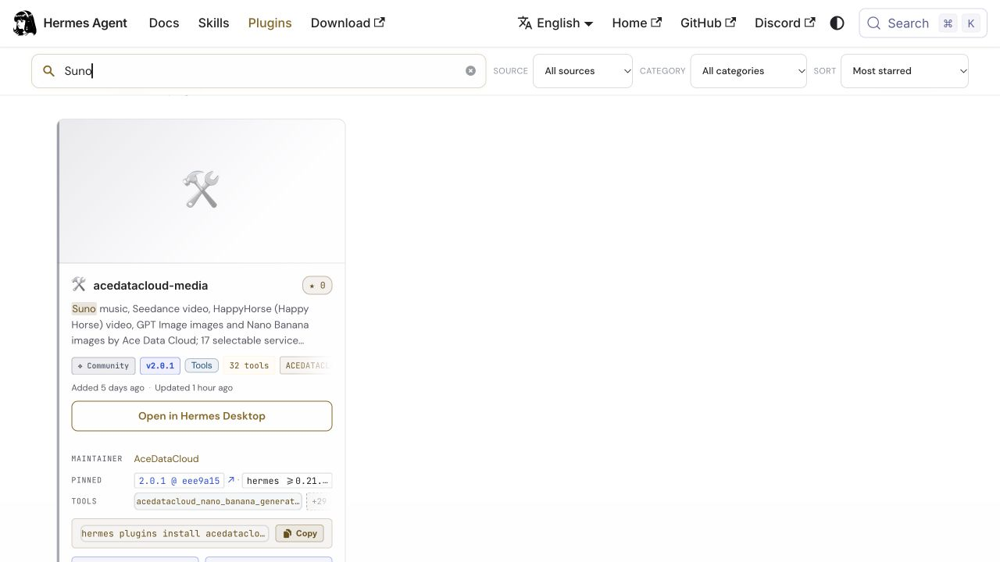

# Suno by Ace Data Cloud for Hermes

Generate instrumental music and retrieve the completed playable audio. This is maintained by **Ace Data Cloud**, uses an **Ace Data Cloud
account/API Token**, and does not claim to be the service maker's official plugin.

## 1. Find and install the official catalog entry

Open [Ace Data Cloud Media in the official Hermes catalog](https://hermes-agent.nousresearch.com/docs/plugins/acedatacloud-media).
Check the maintainer is **AceDataCloud**. You can find this entry with
`hermes plugins search "suno"`; its install name remains `acedatacloud-media`.
Hermes's maintainer requires [one catalog entry for this product line](https://github.com/NousResearch/hermes-agent/pull/135239#issuecomment-6096145033),
so there is no separately reviewed `suno` Ace catalog package.

```sh
hermes plugins install acedatacloud-media --enable
```

Requires Hermes 0.21.6 or newer. This guide ships with source version2.0.2.
The official catalog independently pins a reviewed commit; check its current
version and SHA before installing or updating. Source publication alone does not
change what a catalog installation receives.



Real production catalog screenshot captured2026-10-18, showing one AceDataCloud
media listing at2.0.1/eee9a15. This proves service-name discovery, not a separate
service package, a paid run or default bundling. [Image provenance](../assets/tutorial/SOURCE.md).
[简体中文](zh-CN/suno.md)

## 2. Register or sign in and copy an API Token

1. Open [Ace Data Cloud → Applications](https://platform.acedata.cloud/console/applications?utm_source=opensource&utm_medium=referral&utm_campaign=evergreen&utm_content=hermes_suno_guide_api_key), register or sign in.
2. Open **General application**; if absent, choose **Initialize General Application**.
   Check **Suno** service access, [current pricing](https://platform.acedata.cloud/models?utm_source=opensource&utm_medium=referral&utm_campaign=evergreen&utm_content=hermes_suno_guide_pricing) and balance.
3. Copy the application **API Key**, or choose **Manage Keys → Create** and name a
   dedicated token such as `Hermes Suno`. A service-specific application key
   can access only its service; a General application key uses your permitted services.
4. Review expiration, usage limits and Allowed APIs. If using an API allowlist,
   include both `/suno/audios` and `/suno/tasks`. Query permission
   does not authorize generation. Copy the raw token without `Bearer ` or quotes;
   a `platform-...` management token is not a generation API key.


These are real, redacted Ace console screenshots reused from the Suno Dify guide
at source commit `8d3d03570e73324220f111f7fe343da0792a8071`, reviewed 2026-10-18.
They show Ace account/key steps, not a Hermes screen or a trial-credit promise.

## 3. Put the token in Hermes and select this service

In your **active Hermes profile's terminal**, run the config command below and
replace the placeholder locally with the token. Never paste it into a chat prompt,
screenshot, shared workflow or Git. Keep the active profile's secret store private.

```sh
hermes config set ACEDATACLOUD_API_KEY '<your-api-token>'
hermes tools enable acedatacloud-suno
hermes tools
```

In `hermes tools`, leave only the service toolsets you want enabled, then start a
new session. The separate `acedatacloud` model provider may be installed with
`hermes plugins install acedatacloud --enable`; in `hermes model`, choose **Ace Data
Cloud** and a supported chat model. You can also use another configured model.
Enabling a toolset is separate from choosing a chat model and from a spending limit.

See the [official Hermes model configuration screenshots](https://hermes-agent.nousresearch.com/docs/user-guide/configuring-models)
for the real Models → Change → provider/model picker layout. Those historical
screenshots show another provider; they are not proof of an Ace UI run. This guide
uses the verified Hermes CLI commands, not invented buttons.


This is an **official-screenshot edit preview** of model selection, edited2026-10-17
from the historical v0.11.0 official image (capture date unknown). It does not show
media-tool selection or a paid run. [Exact provenance](../assets/tutorial/SOURCE.md).
For media, use the real `hermes tools` CLI command above; no new GUI is promised.

## 4. First use: submit once, then retrieve the same task

**Every generate call spends Ace Credits with no Hermes approval prompt.** Your
model can choose other costly options. Review this exact request and account
limits before asking the agent to use it; a saved example is not authorization.
Text and reference URLs go to `api.acedata.cloud`. This documentation did not send
a new paid request.

Ask the agent:

> Use acedatacloud_suno_generate once with this approved request, save task_id, then query acedatacloud_suno_task with that same ID.

Arguments for `acedatacloud_suno_generate`:

```json
{
  "prompt": "A short gentle instrumental piano melody for a sunrise, no vocals.",
  "model": "chirp-v6",
  "instrumental": true,
  "duration": 10
}
```

Save the returned `task_id`, then use **`acedatacloud_suno_task`**:

```json
{"task_id":"<the-same-task-id>","wait_seconds":60}
```

Only `status: succeeded` and `success: true` indicate completion. If `pending`,
query **that same ID** again; never rerun the generation to wait. A submit timeout
may mean the generation was accepted: recover its ID from Ace request history
before any resubmission. No automatic submit retry, model fallback or callback
is installed. Duration is a target, not a guaranteed track length. Custom vocals require the title, style and lyric fields. An audio preview is not terminal success.

## 5. Read the result

Illustrative output shape only; replace the placeholders with your actual result:

```json
{"status":"succeeded","success":true,"task_id":"<the-same-task-id>","media_urls":["https://<returned-media-host>/<result>"],"data":{}}
```

Open the returned media link; it may expire. The plugin reports only the requested
media type. A successful install or a green tool call is not proof of generation
completion, media decoding or a unique billing record. Historical live-primary-
operation evidence is retained in [tests/evidence](../tests/evidence/); its date and
old tool names remain historical. Current 0.22.2 acceptance is installation/schema/
registration evidence, not a new paid Suno generation.

## Troubleshooting

- **No search result for a natural service name:** try `suno` and confirm
  the maintainer and `acedatacloud-media` entry. The official description has
  included natural service names since 2026-10-18. An existing Hermes profile may
  retain its catalog cache for up to six hours; check the official catalog page
  before treating a cached missing result as an unavailable service.
- **Tools missing:** confirm the plugin and `acedatacloud-suno` are enabled in this profile,
  the token exists there, and a new session was started. `hermes tools list` shows selection.
- **Authentication/balance error:** check the raw token, service/API allowlist,
  expiration, usage limit and balance. A chat-only key cannot generate media.
- **Still pending or query failed:** keep the same task ID. Inspect request history;
  do not create a replacement generation automatically.
- **Cost questions:** [current pricing](https://platform.acedata.cloud/models?utm_source=opensource&utm_medium=referral&utm_campaign=evergreen&utm_content=hermes_suno_guide_pricing) and your actual package rate/
  billing records are authoritative. No fixed USD or free-credit guarantee is made.

[All Hermes media services](../README.md#services) · [Model provider](https://github.com/AceDataCloud/AceDataCloudModelProviderHermes)
