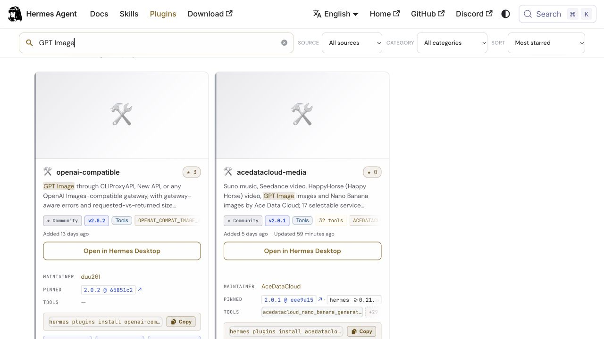
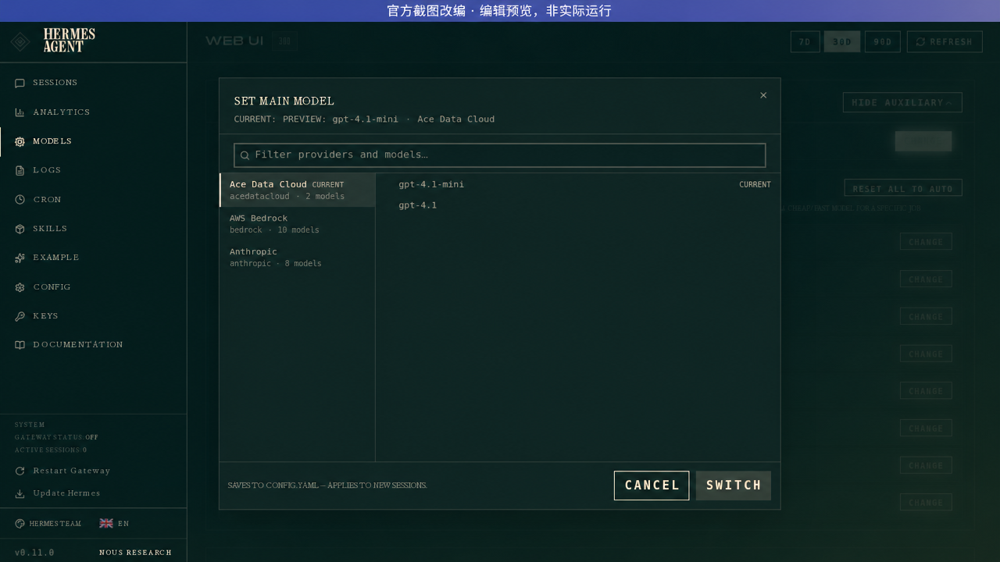

# 在Hermes使用GPT Image：Ace Data Cloud图文指南

[English](../gpt-image.md) · [全部媒体服务](../../readme/README_zh_Hans.md)

GPT Image2单张图片并取得完成后的图片链接。 本集成由**Ace Data Cloud**维护，使用你自己的**Ace账户和API Token**，不冒充服务原厂官方插件。

## 1. 在官方目录找服务并安装

打开[Hermes官方Ace媒体插件页](https://hermes-agent.nousresearch.com/docs/plugins/acedatacloud-media)，核对维护者**AceDataCloud**。在目录中搜索服务名也能找到这一项。安装名仍是`acedatacloud-media`，不是单独的`gpt-image`包。

```sh
hermes plugins search "GPT Image"
hermes plugins install acedatacloud-media --enable
```

最低Hermes0.21.6；本文随源码版本2.0.2提供，目录独立固定审核commit，请核其当前版本/SHA。维护者[明确要求这一产品线只有一个目录项](https://github.com/NousResearch/hermes-agent/pull/135239#issuecomment-6096145033)，各服务使用独立开关；不是五个独立下载安装包。



这是2026-10-18正式网页的原始截图，显示2.0.1、固定eee9a15与Ace维护者。它证明能搜到入口，不证明新生成、默认内置、唯一扣费或营收。[图片来源与边界](../../assets/tutorial/SOURCE.md)。

## 2. 注册、登录并复制API Token

1. 打开[Ace Data Cloud → Applications](https://platform.acedata.cloud/console/applications?utm_source=opensource&utm_medium=referral&utm_campaign=evergreen&utm_content=hermes_gpt_image_guide_api_key)，注册或登录。
2. 进入**General application（通用应用）**；没有时先点**Initialize General Application**。确认**GPT Image**服务访问权限、[当前价格](https://platform.acedata.cloud/models?utm_source=opensource&utm_medium=referral&utm_campaign=evergreen&utm_content=hermes_gpt_image_guide_pricing)和余额。
3. 复制应用卡片上的**API Key**。如需分离管理，在**Manage Keys → Create**创建命名为`Hermes GPT Image`的专用Token。通用应用Key能访问账户获准的服务，专属服务应用的Key只限该服务。
4. 按需检查有效期、消费限制、Allowed APIs。若启用API白名单，须包含`/openai/images/generations`和`/openai/tasks`。查询权限不代表生成授权。
5. 只复制Token原文，不加`Bearer `、引号或空格。`platform-...`平台管理Token不能替代生成Key。不承诺固定免费额度；以账户显示和实际套餐为准。


两张图来自固定SunoDify源提交`8d3d035...`，已脱敏，2026-10-18核对。它们展示Ace账户界面，图片中的Dify名称只是原示例，不是Hermes填写位置或免费额度证明。

## 3. 在Hermes填写Token并只选择需要的服务

在**当前Hermes配置环境的终端**执行，替换占位值。不要把Key贴进聊天、截图、Git或共享工作流；不要写进非secret的config.yaml。

```sh
hermes config set ACEDATACLOUD_API_KEY '<your-api-token>'
hermes tools enable acedatacloud-gpt-image
hermes tools
```

在`hermes tools`检查并关闭不需要的其他服务，然后开启新会话。若使用Ace模型，另执行`hermes plugins install acedatacloud --enable`、`hermes model`，选择**Ace Data Cloud**，填Key并选择已支持模型。也可以使用其他已配置的聊天模型。模型选择、服务启用和消费上限是三个不同设置。



此图2026-10-17基于官方历史v0.11.0截图编辑，原拍摄日未知；只说明原生模型选择布局，**不是本服务开关截图或实际调用结果**。[来源](../../assets/tutorial/SOURCE.md)。服务开关使用上面的真实CLI命令，不承诺新GUI按钮。

## 4. 首用：只提交一次，再查同一任务

**每次生成会立即消耗Ace Credits，没有Hermes逐次确认提示。**模型可能选择更贵的选项，文本和参考URL发送到`api.acedata.cloud`。先确认这次请求的参数、权限、现价、余额与预算，不能把教程示例当消费授权。本次编写没有发送付费请求。

对Agent说明：只用`acedatacloud_gpt_image_generate`提交下方获准参数一次，保留返回的task_id，然后只用`acedatacloud_gpt_image_task`查询同一个ID，不要重新生成来等待。

```json
{
  "prompt": "A teal ceramic cube on a cream background.",
  "model": "gpt-image-2",
  "size": "1024x1024",
  "quality": "low",
  "n": 1
}
```

查询`acedatacloud_gpt_image_task`：

```json
{"task_id":"<同一次返回的task_id>","wait_seconds":60}
```

只有`status: succeeded`和`success: true`才完成。`pending`就继续查**同一个ID**；提交超时也可能已被接收，先去请求历史找回ID，不能自动补发。没有自动重试生成、模型fallback或callback。只说明已声明的GPT Image2图片生成输入；不宣称支持图片编辑或所有Chat/Responses功能。图片质量和数量会影响费用。

## 5. 查看输出与排错

以下仅是字段形状，不是这次实际结果，必须换成你的返回值：

```json
{"status":"succeeded","success":true,"task_id":"<同一次返回的task_id>","media_urls":["https://<返回的媒体域名>/<结果>"],"data":{}}
```

打开`media_urls`里的真实媒体链接，链接可能过期。运行中的预览、安装成功或工具调用绿灯不等于媒体完成、解码成功或唯一扣费。历史主流程证据在[tests/evidence](../../tests/evidence/)，保留原日期；0.22.2免费验收证明安装/schema/工具发现，不是新的付费GPT Image生成。

- **服务名没搜到**：核对官方页和Ace维护者；已有profile目录缓存可保留6小时，自然名称描述已于2026-10-18上线。不要误装别的同名插件。
- **工具不见**：检查本profile插件、`acedatacloud-gpt-image`和Key可用，`hermes tools list`检查选择，开始新会话。
- **认证/额度失败**：检查Token原文、服务与生成/查询白名单、有效期、消费限制和余额。chat-only Key不能生成媒体。
- **一直pending/查询失败**：保留原任务ID查请求历史，不重新生成。
- **费用疑问**：[当前价格](https://platform.acedata.cloud/models?utm_source=opensource&utm_medium=referral&utm_campaign=evergreen&utm_content=hermes_gpt_image_guide_pricing)和账户实际套餐/账单为准，不复制旧USD单价。

本中文指南随源码版本2.0.2提供；GitHub发布与Hermes目录审核pin分开，按名称安装取得目录当前固定commit。只有该commit包含此版本时，用户安装文档才会更新。升级前检查目录版本与SHA，本文不把源码发布等同目录已更新。
